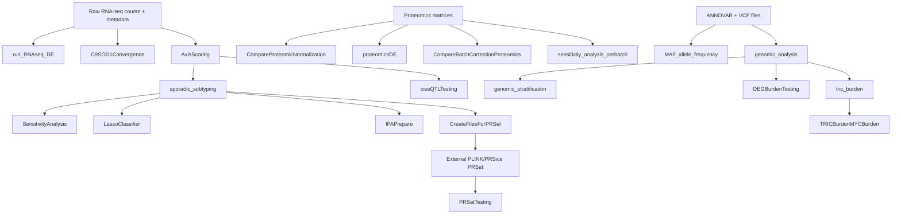

# Workflow DAG and run order

## Recommended execution order

1. `scripts/refactored/transcriptomics/01_progression_rnaseq_de.R`
2. `scripts/refactored/transcriptomics/02_c9_sod1_convergence.R`
3. `scripts/refactored/transcriptomics/03_axis_scoring.R`
4. `scripts/refactored/subtyping/01_sporadic_subtyping.R`
5. `scripts/refactored/validation/03_ipa_prepare.R`
6. `scripts/refactored/validation/02_lasso_classifier.R`
7. `scripts/refactored/validation/01_sensitivity_analysis.R`
8. Proteomics scripts: normalization, differential abundance, batch correction, Python pre/post sensitivity.
9. Genomics scripts: MAF, burden, network stratification, DEG burden, TRiC, MYC.
10. PRS/eQTL scripts after external PLINK/PRSice and dosage generation.

Use `--objects` for downstream scripts that previously required objects to exist in the R session.
